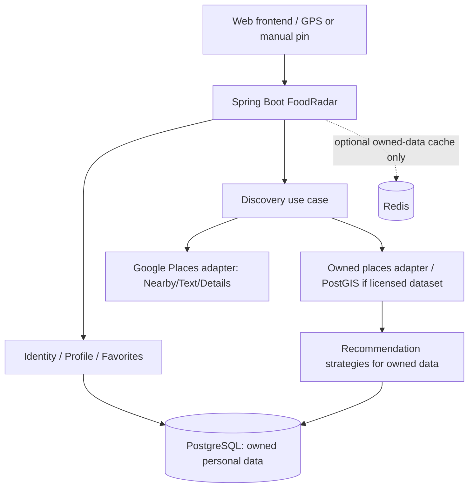
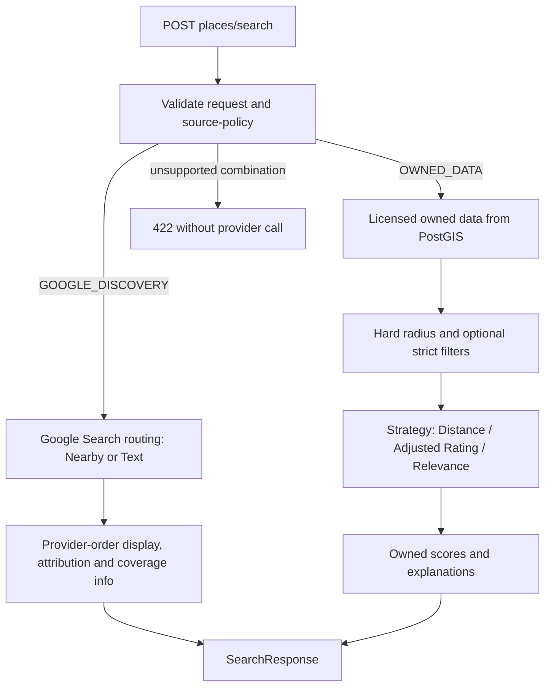

# FoodRadar – High-Level Architecture (Proposed v1.1)

- **Cập nhật:** 2026-11-12; liên kết [SRS v1](product-requirements.md), [ADR list](adr/README.md), [OpenAPI](openapi.yaml).
- **Nguyên tắc:** Modular Monolith; một Spring Boot deployable, package by feature, PostgreSQL + Flyway; ports/adapters tại boundary. Google provider không là nguồn cho custom ranking mặc định.

## 1. System context



## 2. Controlled search flows



- Google Nearby: provider circle restriction và `rankPreference=DISTANCE` mặc định, `isRadiusStrict=true` per provider semantics, `isExhaustive=false`.
- Google Text: `locationBias.circle`, **not strict radius**, `isExhaustive=false`; no geographic post-filter on Google coordinates without licensing decision.
- Owned: strict PostGIS radius only over owned indexed dataset. Synthetic dataset test/demo only.
- Google mode preserves provider order; **never** runs FoodRadar strategy or computes Google-derived distance/score in MVP.

## 3. Domain packages

```text
com.foodradar
├── identity        # register/login/refresh/logout, sessions
├── profile         # preferences, account deletion
├── discovery       # source policy, retrieval, response assembly
│   ├── api
│   ├── application
│   ├── domain
│   └── infrastructure
│       ├── google   # HTTP adapter, no raw response logging
│       └── owned    # enabled when licensed data exists
├── recommendation  # owned-only strategies
├── favorites       # (user, provider, provider_place_id)
└── shared          # common error/request-id only
```

No message broker, auto-pagination or Redis required for MVP. No cross-module direct table writes. `GoogleDiscoveryPort` and `OwnedPlaceRepository` are separate abstractions: a common response DTO does **not** imply equivalent legal permissions.

## 4. Error and reliability

- 400: invalid request; 422: unsupported source/filter combination (no paid provider request).
- 429 `CLIENT_RATE_LIMITED` only for client API; 503 `PROVIDER_QUOTA_EXHAUSTED` for upstream quota; 503 config/disabled; 502 provider response errors, 504 timeout.
- Bounded timeouts/calls, không tự retry provider search trong MVP để giữ tối đa một search call mỗi user request; total request deadline; rate-limit guest/user.
- Observability: request counts, external calls/SKU estimate, p95 separately for stub and live, errors, no precise GPS logs/API key/raw Google responses.

## 5. Deployment and governance

Docker Compose for dev, CI (unit + contract + Testcontainers + OpenAPI/schema tests), a cloud VM when release gated. Use short-lived access JWT, opaque rotating refresh cookie, session revocation and CSRF/Origin protection. Google API key only in server-side secret store with API restriction/quotas. Production Google UI needs logo/attribution/Privacy/Terms review and suitable map implementation.

## 6. Gate status

- Design and stub implementation: **GO** sau khi chủ dự án chấp thuận ADR; hiện các ADR vẫn Proposed.
- Live Google PoC: **PENDING** approved key/billing/quota; run bounded smoke script only.
- Public beta and ranking derived from Google: **NO-GO** until provider/license approval and release checklist pass.
