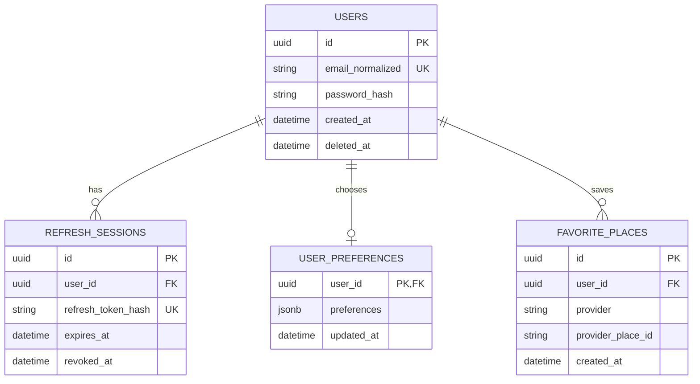

# FoodRadar – Data model, privacy & provenance (Proposed v1.1)

- **Cập nhật:** 2026-11-09; theo [ADR-003](adr/0003-postgresql-primary-database.md), [ADR-004](adr/0004-google-places-provider.md), [SRS](product-requirements.md).
- **Trạng thái:** Technical design; chưa là Privacy Policy hay giấy phép Google.

## 1. Data ownership and retention

| Data | Ownership / source | Stored? | Notes |
|---|---|---|---|
| Google Place ID | External Google identifier | Yes, as opaque reference | Place ID caching exception; refresh/recover stale ID |
| Google name/rating/reviews/location/raw response | Google Maps Content | **No persistence by default** | request-scoped only; no Redis cache; do not create derivative scoring/geo attributes |
| User email/password hash | User / FoodRadar | Yes | email normalized unique, salted adaptive hash; never plain passwords |
| Refresh session | FoodRadar | Yes, hashed token + revoked/expiry | rotating opaque refresh tokens, replay detection |
| Preferences | User | Yes | own data only; GET/PUT/delete |
| Favorites | User | Yes | user_id, provider, provider_place_id, created_at; no displayName/rating snapshot |
| Search GPS | User/device | No | no precise coordinates in logs/history by default; manual pin allowed |
| Owned/partner places | Owned/licensed | When separately enabled | proof of license/consent, provenance and lawful purpose |
| Synthetic places | Test fixtures | Dev/test only | MUST NOT be returned as actual businesses in public |
| Analytics/feedback | User | Out of MVP | opt-in, retention and deletion design required before enabling |

Coordinates can have limited permitted caching exceptions in Google's policies, but **MVP deliberately does not use them**. A caching exception does not imply a right to produce independent geographic content.

## 2. Conceptual ERD

DB constraints: `UNIQUE (user_id, provider, provider_place_id)`, normalized email unique; provider value CHECK/enum. Owned-place/PostGIS tables require distinct migration and provenance fields, not mirrored Google Places attributes. Refresh tokens stored **hashed**, rotation in one transaction with compare-and-swap or locking to reject concurrent reuse.

## 3. Privacy & security decisions to confirm before public

- GPS permission only on user request; refusing GPS does not block manual map pin selection.
- No precise search coordinate, API key, full Google payload or raw password in logs/metrics. Correlation via `requestId`.
- Access token short TTL; refresh in Secure/HttpOnly/SameSite cookie, CSRF token & Origin checks, session revocation; specify exact cookie domains and CORS in security LLD.
- Define retention periods (suggested technical logs ≤30 days as provisional), deletion process and backup retention; user deletion route must have implementation tests and accurate API semantics.
- Publish user-facing Terms and Privacy Policy, include Google terms/privacy references and attribution according to Google's current policy.
- No Google Maps Content used for ML training/testing/validation/fine-tuning; no source-derived user profiling by default.

## 4. Provenance rule

Persist data only if `origin`, `license/permission`, `retention_policy`, and `purpose` are documented. Do not assume `provider=GOOGLE_PLACES` confers the same rights as `provider=FOODRADAR_OWNED`. `sourceMode` chooses both retrieval behavior and allowed processing.

## References

- [Places Policies](https://developers.google.com/maps/documentation/places/web-service/policies)
- [Maps Terms](https://cloud.google.com/maps-platform/terms)
